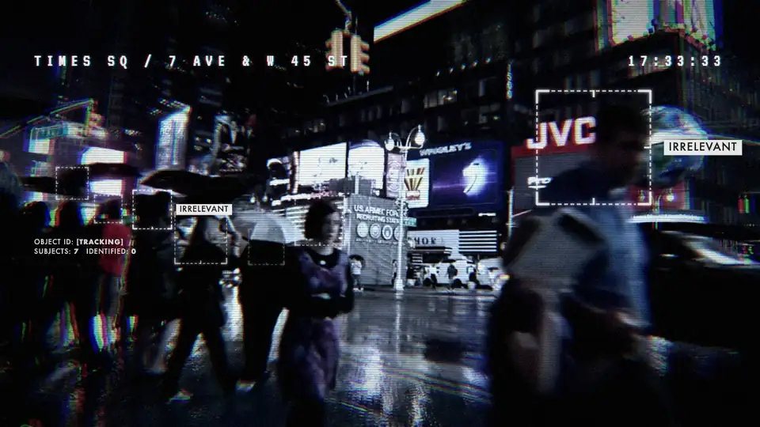
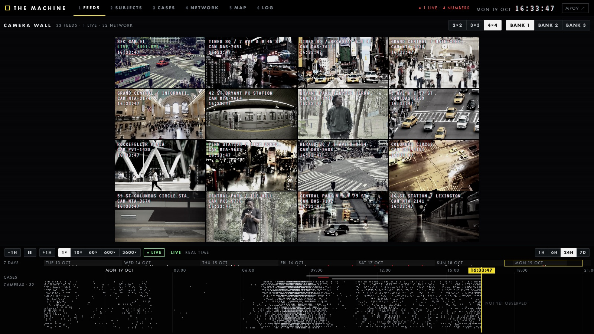
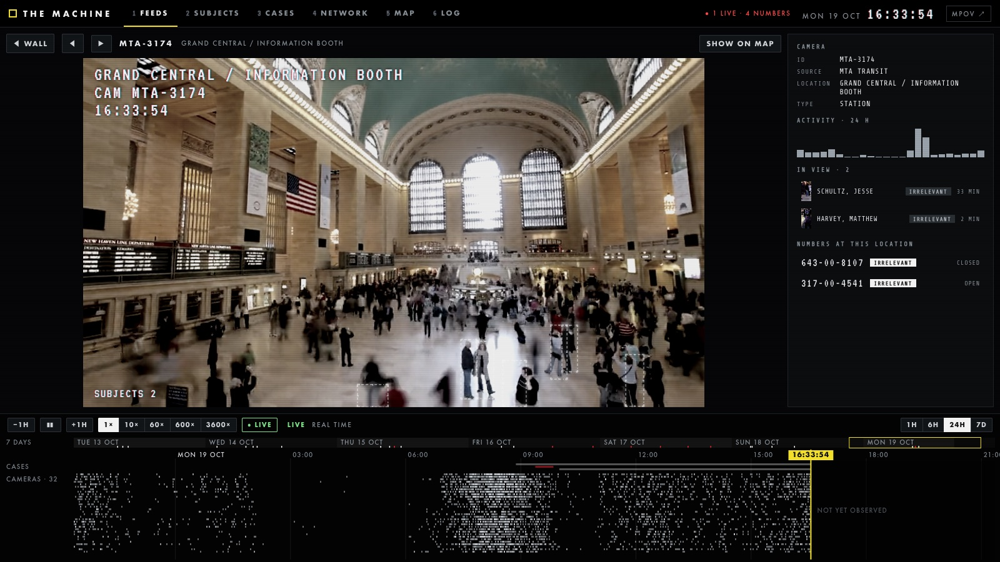
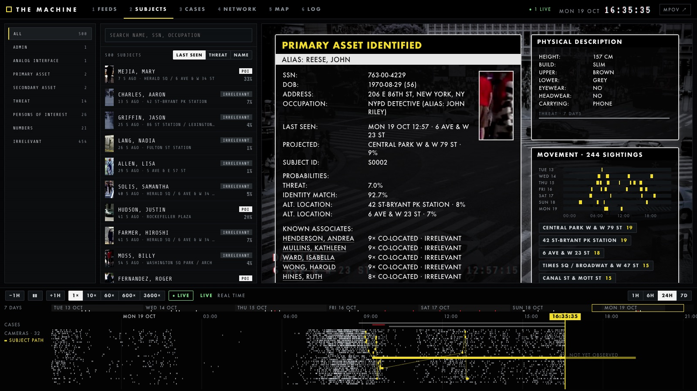
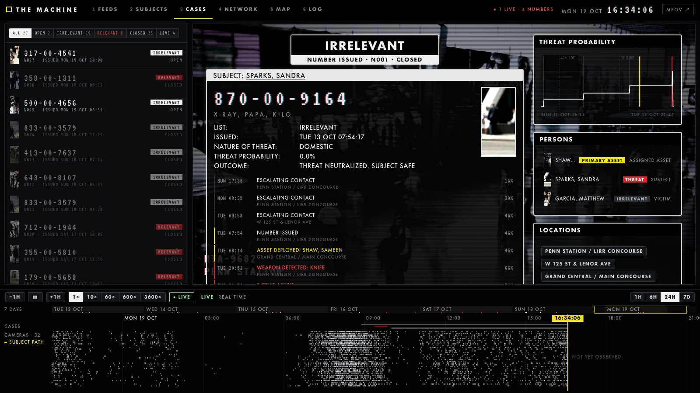
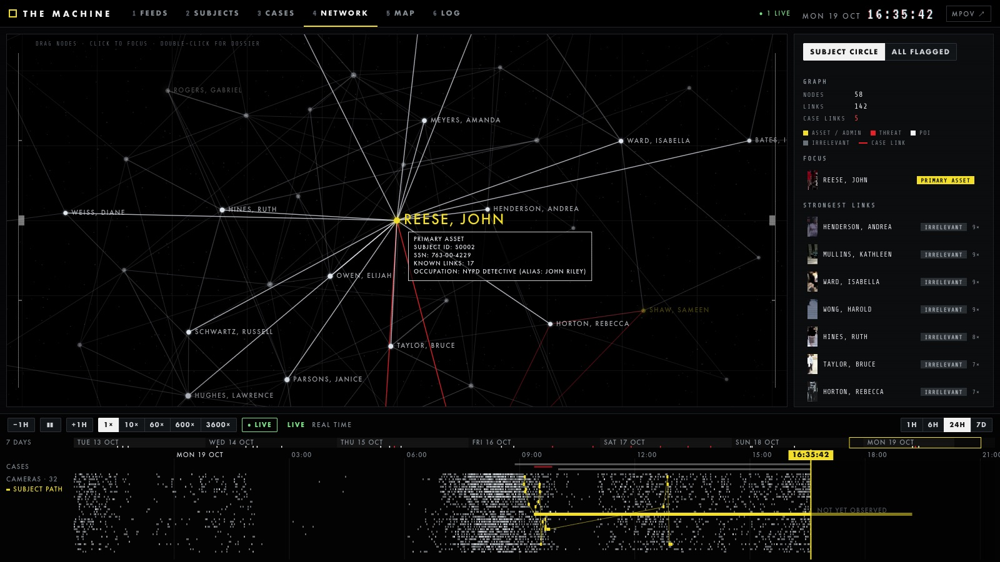
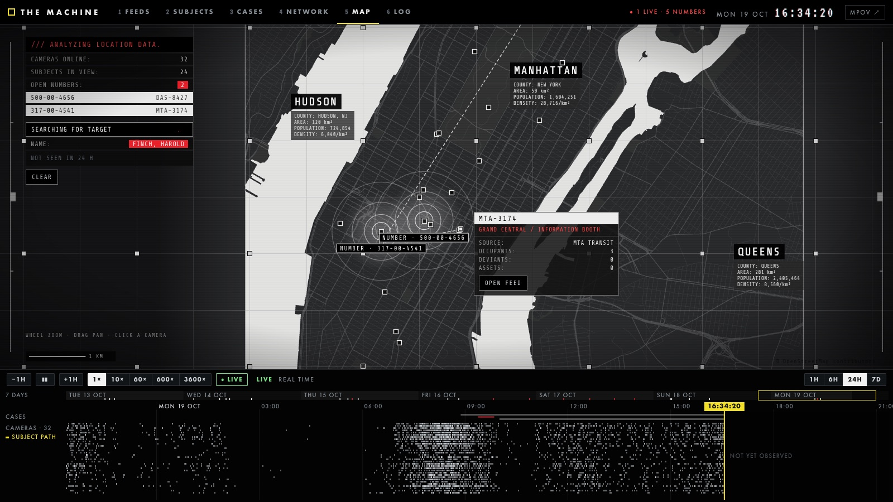
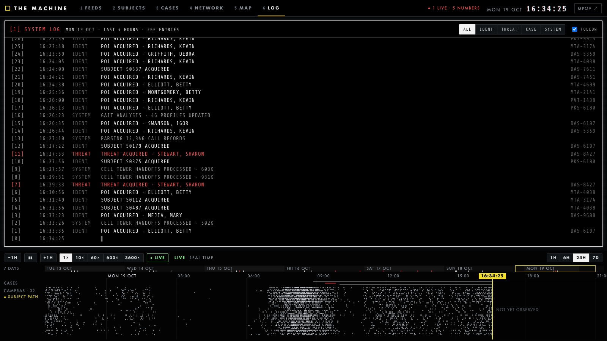
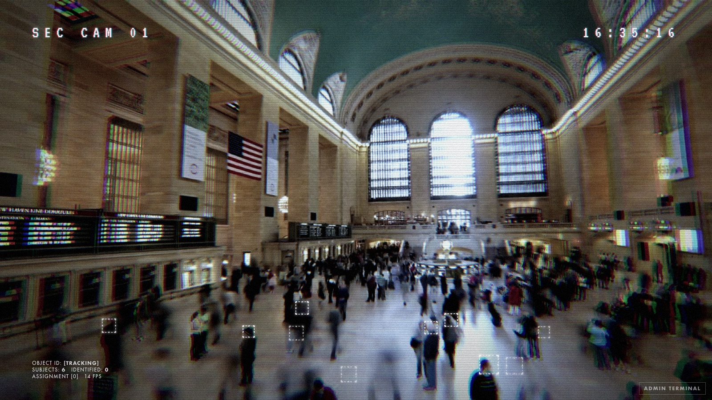

<div align="center">

# THE MACHINE

*"You are being watched."*

[English](README.md) · **简体中文** · [日本語](README.ja.md) · [한국어](README.ko.md) · [Русский](README.ru.md)

<a href="https://rosehahah.github.io/the-machine/"></a>

**[▶ 在浏览器里打开控制台](https://rosehahah.github.io/the-machine/)** &nbsp;·&nbsp; [接自己的摄像头运行](#快速开始) &nbsp;·&nbsp; [怎么做出来的](#怎么做出来的)

<sub>📷 想让机器判定<i>你</i>？我把这个项目的监控风格界面做成了我的 iOS 相机 App <b>苋在相机</b>（XianNow Camera）里的拍照模式（下个版本上线）→ <a href="https://apps.apple.com/app/id6814311061?ct=machine_readme">App Store</a></sub>

</div>

粉丝自制、开源的《疑犯追踪》（*Person of Interest*）**The Machine** 复刻。它的视角（MPOV）跑在你自己的 Mac 和 iPhone 摄像头上：框出画面里的每个人，认出你是 ADMIN，发现有人拿刀或摔倒，然后给出一个号码——它从不解释原因。另外还有一个多页面的控制台（摄像头墙、人员、案件、关系网、地图、日志），跑在一座 500 人的 mock 城市上。

每一个方框、标签和颜色都对照过全五季的画面。剧里没出现过的东西，代码里和下文都标为「自创」。

<sub>上面的动画是演示站的首页：素材视频 + 真实的人体轨迹，身份识别是脚本安排的（画面里没有任何人被录入）。</sub>

**深深感谢《疑犯追踪》。** 感谢 Jonathan Nolan、Greg Plageman、J.J. Abrams 和所有编剧、演员、幕后人员。谢谢你们的五季，谢谢 Finch 和 Reese，Root 和 Shaw，Fusco 和 Carter，还有 Bear——也谢谢 The Machine。我们真的太爱这部剧了。这个项目因你们而存在。

## 控制台

六个页面共用底部的时间轴：可以拖动回看 mock 城市的 7 天，也可以看实时。

| | |
|---|---|
|  **1 FEEDS** · 摄像头墙，32 个曼哈顿真实路口 |  **1 FEEDS** · 单路画面 |
|  **2 SUBJECTS** · 档案：PRIMARY ASSET IDENTIFIED |  **3 CASES** · 号码 |
|  **4 NETWORK** · 谁和谁同框过 |  **5 MAP** · 曼哈顿，进行中的行动 |
|  **6 LOG** · 系统日志 |  **MPOV** · 实时视角，本地运行 |

<sub>截图来自本项目运行 mock 数据和 [Mixkit](https://mixkit.co) 素材的画面，不含任何剧集画面。</sub>

## MPOV 能做什么

- **框出每个人**：Mac 摄像头和 iPhone（连续互通相机）都行。方框是剧里那种正方形、框头肩的：虚线边、实线角、中点刻度。
- **认出你**：把自己录成 `ADMIN` 后，方框会从白色闪成黄色，弹出档案卡，并显示 `GOOD EVENING, ADMIN.`。其他角色：`PRIMARY ASSET`、`SECONDARY ASSET`、`ANALOG INTERFACE`、`IRRELEVANT`。
- **跟着你**在多个摄像头之间切换。
- **判断威胁**：有人拿起刀、剪刀、球棒或枪 → 白框红角；真的动手 → 红框 `THREAT`；有人摔倒 → `SUBJECT DOWN`。
- **发号码**：剧里 `###-00-####` 格式的 SSN，加一句无线电字母暗语，配两声公用电话铃。分 RELEVANT / IRRELEVANT 两张名单，弹 macOS 通知，也可以用 iMessage 发到你手机上。

## 快速开始

只支持 macOS。需要 [uv](https://docs.astral.sh/uv/) 和 `ffmpeg`。

```bash
brew install uv ffmpeg
git clone https://github.com/rosehahah/the-machine
cd the-machine && ./run.sh
```

第一次运行会自动建 Python 环境、下载模型（约 75 MB，`tools/fetch_models.sh`）和控制台用的素材（`tools/build_clips.py`），要等几分钟。之后浏览器会打开 **http://localhost:8000**（MPOV），控制台在 **http://localhost:8000/console**。在终端按 `Ctrl+C` 退出，摄像头会一起关闭。

- **摄像头权限**：macOS 可能弹窗请求摄像头权限，点「允许」。如果画面显示 `NO SIGNAL`，去 系统设置 → 隐私与安全性 → 摄像头，打开你所用终端 App 的开关，然后重新启动。
- **iPhone 摄像头**：用的是「连续互通相机」。iPhone 要锁屏、放在 Mac 旁边，并且和 Mac 登录同一个 Apple ID。系统会自动把它加为第二路画面。如果开机时没接上，接上后在终端面板里点 RESCAN CAMERAS。

### 把自己录成 ADMIN

1. 按 `M` 打开 ADMIN TERMINAL。
2. 在 ENROLL SUBJECT 里填名字（比如 `FINCH, HAROLD`），角色选 `ADMIN`。
3. 一个人面对当前摄像头，距离大约一臂，点 **ENROLL FROM CURRENT FEED**。
4. 保持不动约 2 秒，看到 `PROFILE COMPILED` 就录好了。

之后每次你出现在画面里，方框会从白色闪成黄色，旁边出现 `ADMIN` 标签、档案卡和问候。`PRIMARY ASSET` 和 `SECONDARY ASSET` 是黄框，`ANALOG INTERFACE` 是黑框黄角，`IRRELEVANT` 是白框。没录入的人一律白框。

### 威胁和号码

规则按剧里的方框图例来：

| 方框 | 什么时候出现 |
|---|---|
| 白框 | 普通人 |
| **白框红角 + 红色准星**，`POTENTIAL THREAT` | 手里拿着刀、剪刀、球棒或枪，但还没动手 |
| **红框**，`THREAT` | 拿着武器又「动手了」：持械超过 4 秒，或者靠近别人，或者跟 ADMIN / 资产同在一个画面（这种直接变红） |
| 方框慢闪，`SUBJECT DOWN` | 有人摔倒：头快速掉到很低的位置并停在那里，或者从画面底部摔出去 |

- **已录入的人拿武器不会变色**。剧里 Reese 一直带枪，方框始终是黄的。要在自己身上看效果，用下面的演练。
- 每次出事都会产生一个**号码**。已录入的人号码固定；陌生人只有匿名编号 `UNKNOWN-0427`，号码每次随机，不跟任何外部数据比对。号码只存在内存里，重启就清空。
- **两张名单**：ADMIN 或资产被威胁、或者摔倒 → `RELEVANT`；其他 → `IRRELEVANT`。在 ADMIN TERMINAL → THE LIST 里查看、跳到对应摄像头、结案。
- **演练**（ADMIN TERMINAL → DRILLS）：`SIMULATE ARMED SUBJECT` 让画面里最大的那个人「拿上武器」6 秒，`SIMULATE SUBJECT DOWN` 让他「摔倒」。演练会无视「已录入的人不升级」这条规则，所以一个人也能试。号码上会标 `DRILL`。
- **推送**（ADMIN TERMINAL → DISSEMINATION）：macOS 通知默认开。iMessage 要填手机号或 Apple ID 再点 SAVE（默认关，只发号码和暗语，不发照片）。`SEND TEST` 可以先试一下。

武器检测用两个模型：YOLOX 每帧都跑，快但认不准手里的刀；OWLv2 在后台轮流复核有人的画面，每路约 2 秒一次，认得出手里拿的刀和枪。所以从拿起刀到方框变化大约要 2–4 秒。一直放在同一个位置的刀（刀架、墙上挂的）会被当成摆设忽略；启动时画面里已有的刀也一样。

### 快捷键

| MPOV | |
|---|---|
| `M` | 打开或关闭 ADMIN TERMINAL |
| `1`–`9` | 切换摄像头（同时关闭自动跟随） |
| `F` | 全屏 |
| `X` | 开关画面调色和质感效果 |
| `Esc` | 关闭终端面板 |

**自动跟随**（终端里的 AUTO-FOLLOW）：已识别的人离开当前摄像头、出现在另一个摄像头时，画面会自动切过去。

**控制台**：`1`–`6` 切页，`空格` 播放/暂停，`←` `→` 前后 1 分钟（按住 `Shift` 是 1 小时），`L` 回到实时，`F` 全屏，`Esc` 从单路画面回到摄像头墙。地图用滚轮缩放、拖动平移、点机位看信息卡。

### 不开摄像头

```bash
./run.sh --no-cameras --source ~/Movies/clip.mp4   # 只用一个视频文件
./run.sh --source photo.png                        # 摄像头 + 额外一路
```

## 控制台逐页说明

mock 城市由 `tools/gen_world.py` 生成：500 人、7 天、32 个曼哈顿真实路口机位、30 个号码。服务启动时如果日期窗口过期会自动重新生成（演示站上，这 7 天永远截止到今天）。真实摄像头和号码会以 LIVE 的形式并入。

| 页 | 内容 | 对照的画面 |
|---|---|---|
| `1` FEEDS | 摄像头墙（16:9 拼墙）和单路画面 | S1 监控拼贴；S2 的机位角标，比如 `WASH SQ PK 8 11 / 11:15:51` |
| `2` SUBJECTS | 人员目录和档案，档案浮在此人最后出现的机位画面上 | S05E02 08m17s 的 `PRIMARY ASSET IDENTIFIED` 面板 |
| `3` CASES | 号码列表和案件详情 | 双层状态条（SPEC §4）+ 同一种档案面板 |
| `4` NETWORK | 谁和谁同框过（*关系图本身是自创*） | 外观借用 S2–S3 全国地图：黑底、光点、Futura 白字、细白框 |
| `5` MAP | 曼哈顿地图、机位、开着的号码、某人的 24 小时轨迹 | S04E13 37m42s、S04E21 36m04s：白水面深陆地、1 km 网格、区名统计框、红色十字准星、`ACTIVE OPERATION` 同心圆 |
| `6` LOG | 识别、案件和系统消息的流水（*日志页本身是自创*） | S05E13 36m04s 系统框 `[1] CORE SYSTEMS SHUTTING DOWN` |

地图由 `tools/build_map.py` 从 OpenStreetMap 取曼哈顿的街道和海岸线（用 shapely 把海岸线闭合成陆地），缓存在 `media/osm_manhattan.json`，输出 `web/data/manhattan.json`。

## 怎么做出来的

这个项目只有一条规矩：**屏幕上的每个元素都要能对上剧里的某一帧。** 剧里没有的，就标成「自创」，不偷偷塞进去。

1. **规范。** [`research/SPEC.md`](research/SPEC.md) 依据约 30 张剧照和 wiki 的方框符号，把 MPOV 定下来：两个视觉时代（S1 监控摄像头、S3–S5 调过色的 MPOV）、方框几何、颜色图例、标签、黑白双层状态条、档案卡和调色。证据不足的地方标了「待核对」。
2. **在 103 集里搜。** `tools/index_clip.py` 用 CLIP 给全剧的帧建索引；`tools/find_shots.py` 可以用剧照或一句话（比如「a map of Manhattan with a red crosshair」）去搜。搜到的就是上表里那些参考帧。这一步需要你自己的片源，索引和帧都不在仓库里。
3. **重做，再对照。** 每一页都是对着参考帧重做、再对照一遍。这样抓出来的错误有：方框必须是正方形、框头肩，不是全身长方形（`web/hud.js` 的 `headBox()`，和 `backend/vision.py` 的 `head_from_person` 同一规则）；TCK 卡、红色 ▽、`ELIMINATE`、白底 `DEVIANT` 都属于撒玛利亚人的视角（SPOV），所以这里一个都没用。

其余是常规工程：ffmpeg 采集摄像头，YOLOX 检测人体，YuNet + SFace 检测和识别人脸，ByteTrack 跨帧跟踪，OWLv2 复核武器。界面用 WebGL 做调色、Canvas 画方框，字体是 Futura。

## 隐私

- 人脸只留在你的 Mac 上。录入的人脸特征存在 `data/identities.json`，删掉这个文件就清空了所有人。
- 不上传任何东西。陌生人永远不会被认出身份，只有匿名编号。
- 不推断年龄、性别、情绪。
- `data/`、模型、素材视频和任何剧集画面都在 `.gitignore` 里。

## 文件

| 路径 | 内容 |
|---|---|
| `backend/server.py` | 本地服务：视觉主循环和 API |
| `backend/cameras.py` | 画面来源：用 ffmpeg 接 Mac 和 iPhone 摄像头，以及视频和图片文件 |
| `backend/vision.py` | 人体（YOLOX）、人脸（YuNet + SFace）、跟踪（ByteTrack） |
| `backend/threat.py` | 威胁引擎：持械、升级、摔倒 |
| `backend/numberbook.py` | 号码、两张名单、通知和 iMessage |
| `web/` | MPOV：`fx.js`（WebGL 调色）、`hud.js`（方框和标签）、`app.js` |
| `web/console/` | 控制台：`pages/` 里每页一个文件，`world.js` 读 mock 数据，`timeline.js` 是共用时间轴 |
| `web/fonts/` | VT323（机位角标的像素字）、Share Tech Mono（S4–S5 卡片和地图上的等宽字），都是 OFL |
| `tools/gen_world.py`、`tools/build_map.py`、`tools/build_clips.py` | mock 城市、曼哈顿地图、素材视频和其中的人体轨迹 |
| `tools/fetch_models.sh`、`tools/export_owlv2.py` | 下载 YuNet、SFace、YOLOX；把 OWLv2 导出成 ONNX（360 MB，可选；没有它，武器检测只用 YOLOX） |
| `tools/index_clip.py`、`tools/find_shots.py` | 全剧 CLIP 帧索引和搜索（需要自己的片源） |
| `site/`、`tools/build_site.sh` | 演示站；`tools/build_site.sh --publish` 推到 `gh-pages` |
| `research/SPEC.md` | MPOV 界面规范 |
| `data/` | 录入的人脸和推送设置。只在本机，不进仓库 |

## 进度

- **已完成**：P0 规范 · P1「看得见」· P2「认得出」（录入、识别、多摄像头、自动跟随）· P3「会判断」（持械、摔倒、红框、两张名单、号码、推送）· 六页控制台和演示站。
- **还没做**：P4 及以后：推演树、拼接语音、和 Admin 对话、午夜清空、撒玛利亚人。
- 威胁目前只看两件事：手里的武器、摔倒。打架、尾随这类判断需要姿态模型。
- 武器检测有漏检：挥得快、画面糊、刀侧对镜头时都难认。
- 识别只靠人脸。背对镜头的人有框但没有名字；已经认出的人转过身，在同一个摄像头里会保持身份。

## 致谢

*非官方粉丝项目，与 CBS、Warner Bros. Television、Kilter Films、Bad Robot 没有关系，也未获其认可。剧名和剧中一切归原权利人所有。仓库里不含任何剧集画面。*

- 地图：© [OpenStreetMap](https://www.openstreetmap.org/copyright) 贡献者，ODbL
- 素材：[Mixkit](https://mixkit.co)（Mixkit Stock Video Free License），运行时下载，不再分发
- 模型：OpenCV model zoo 的 YuNet（MIT）、SFace（Apache-2.0）、YOLOX（Apache-2.0）；Google OWLv2（Apache-2.0）
- 字体：VT323、Share Tech Mono（SIL OFL 1.1）
- 代码：MIT，见 [`LICENSE`](LICENSE)
